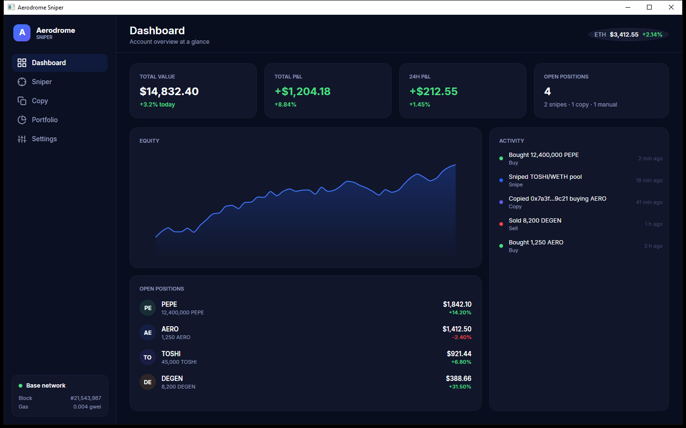
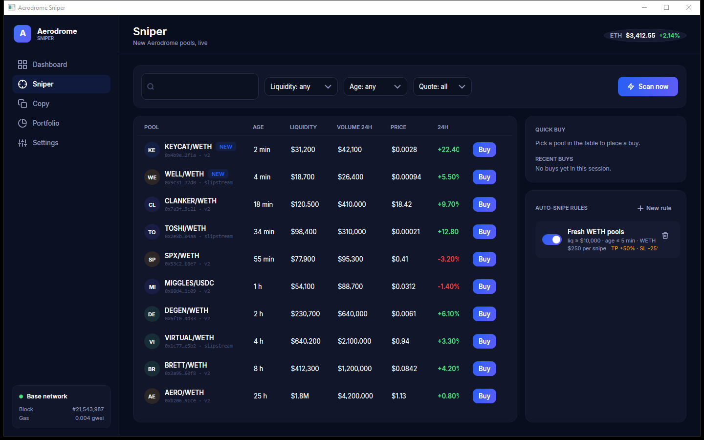

# Aerodrome Sniper

A Windows desktop terminal for trading on Aerodrome Finance (Base).
It shows new pools the moment they appear, mirrors wallets you follow,
and keeps balances, positions and fills in one window.

## What it does

- **Sniper** — live feed of new Aerodrome pools with liquidity, age and quote
  filters, one-click buy, and auto-snipe rules with take-profit / stop-loss.
- **Copy** — add any Base wallet and the app mirrors its Aerodrome swaps,
  either a fixed amount or a percent of the traded size.
- **Portfolio** — balances, open positions with live P&L, and the full trade
  history with side/source/token filters.
- **Dashboard** — equity curve, day and total P&L, recent activity.

Market data comes from public APIs: GeckoTerminal for pools and prices,
Blockscout for wallet activity, Base RPC for chain state. No API keys needed.

## Install

Grab the latest build from the Releases page and unpack it anywhere.
Windows 10 or 11 with the .NET 8 Desktop Runtime is all it asks for.

## Build from source

```bash
git clone https://github.com/codberg18/aerodrome-sniper.git
cd aerodrome-sniper/src
dotnet build
dotnet run --project AerodromeSniper
```

## Where things live

- Poll intervals, API endpoints, slippage and fee defaults: Settings page.
- Account, positions, history, watchlist and rules: `%AppData%\AerodromeSniper`.
- Logs: `%LocalAppData%\AerodromeSniper\logs`.

## Screenshots




